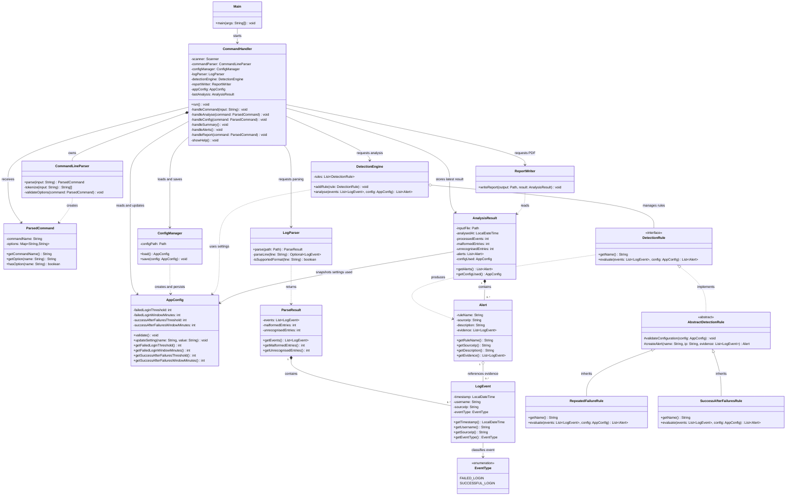

## Class Diagram

## Class Diagram Explanation

### Overview

The class diagram illustrates the structure of the Java Security Log Analyser and how its classes work together. Each class has a specific responsibility, separating user interaction, configuration management, log parsing, detection and report generation. This makes the system easier to maintain, test and extend.

The `CommandHandler` coordinates user commands and communicates with the relevant components. The `CommandLineParser` interprets commands and their options, while `ConfigManager` loads and saves persistent settings. The `LogParser` converts supported authentication log entries into structured `LogEvent` objects. These events are passed to the `DetectionEngine`, which evaluates them using the available detection rules.

When a rule identifies a pattern matching its criteria, it produces an `Alert`. The alerts, processing statistics and configuration used for the analysis are stored in an `AnalysisResult`. Finally, `ReportWriter` uses this result to generate a PDF report.

### Object-Oriented Design

The diagram demonstrates several object-oriented programming principles:

- **Encapsulation:** Classes manage their own data and expose appropriate methods to access or modify it. For example, `AppConfig` manages detection thresholds and validates configuration changes.
- **Inheritance:** `RepeatedFailureRule` and `SuccessAfterFailuresRule` inherit shared functionality from `AbstractDetectionRule`, reducing code duplication while allowing each rule to implement its own detection logic.
- **Abstraction:** `AbstractDetectionRule` provides a common foundation for detection rules, while the `DetectionRule` interface defines the operations that detection rules must support.
- **Polymorphism:** The `DetectionEngine` can evaluate different detection rules through the same `DetectionRule` interface, without needing separate handling logic for each rule type.

These principles support a modular design in which new detection rules can be introduced with minimal changes to the existing detection engine.

### Diagram Symbols and Relationships

The symbols and lines in the class diagram describe how classes relate to one another and how many objects can participate in each relationship.

| Symbol | Meaning | Example in the project |
|---|---|---|
| Dashed line with a hollow triangle | **Interface implementation:** a class provides the behaviour required by an interface. | `AbstractDetectionRule` implements `DetectionRule`. |
| Solid line with a hollow triangle | **Inheritance:** a subclass inherits accessible properties and methods from a parent class. | `RepeatedFailureRule` extends `AbstractDetectionRule`. |
| Filled diamond | **Composition:** a strong ownership relationship in which the whole controls the lifecycle of its parts. | Could represent `CommandHandler` owning its `CommandLineParser`, if implemented this way. |
| Hollow diamond | **Aggregation:** a relationship in which an object groups other objects that can exist independently. | Could represent `DetectionEngine` managing independently created detection rules. |
| Dashed arrow | **Dependency:** one class uses another to perform a task, without necessarily owning it or maintaining a permanent reference. | `ReportWriter` uses `AnalysisResult` to generate a PDF report. |
| `1` | Exactly one related object. | Each `LogEvent` has one event type in the proposed model. |
| `0..1` | Zero or one related object. | An optional relationship. |
| `0..*` | Zero or more related objects. | An `AnalysisResult` can contain zero or more alerts. |
| `1..*` | One or more related objects. | A collection that must contain at least one object. |

Multiplicity values are written beside the ends of relationship lines to indicate how many objects may participate in a relationship. For example, `AnalysisResult "1" *-- "0..*" Alert` indicates that one analysis result can contain zero or more alerts. This allows the system to represent log files that produce no alerts as well as those that produce multiple alerts.

### Design Considerations

The class diagram represents the intended structure of the application and should be checked against the final source code. In particular, composition and aggregation should only be used where the actual object ownership and lifecycle justify them. Similarly, inheritance and interface implementation should reflect the relationships used in the Java classes.

Overall, the design aims to separate responsibilities, reuse common functionality and make the application easier to test and maintain. It also allows additional detection rules to be introduced without unnecessarily changing the existing components.