Java Security Log Analyser — Class Diagram

Application classes

```mermaid
classDiagram
direction TB

class Main {
  +main(args: String[]) void
}

class CommandAlerts {
  -List~Alert~ alerts
  +addAlerts(newAlerts: List~Alert~) void
  +displayAlerts(alerts: List~Alert~) void
  +handleAlerts() void
  +getAlerts() List~Alert~
}

class CommandAnalysis {
  -String GREEN
  -String RED
  -String RESET
  -CommandConfig commandConfig
  -CommandSummary commandSummary
  +CommandAnalysis(commandConfig: CommandConfig, commandSummary: CommandSummary)
  +handleAnalysis(cliScanner: Scanner, commandAlerts: CommandAlerts) void
  -verifyLogFilePath(logFilePath: String) boolean
  -analysisComplete(logEntries: int, malformedEntries: int, unrecognisedEntries: int, otherSshEntries: int, alerts: List~Alert~) void
}

class CommandConfig {
  -DetectionConfig detectionConfig
  +handleConfig(cliScanner: Scanner) void
  +updateIpConfig(cliScanner: Scanner) void
  +updateTimeConfig(cliScanner: Scanner) void
  +getDetectionConfig() DetectionConfig
  +viewConfig() void
}

class CommandHandler {
  -String CYAN
  -String GREEN
  -String RESET
  -CommandAnalysis commandAnalysis
  -CommandAlerts commandAlerts
  -CommandReport commandReport
  -CommandConfig commandConfig
  -CommandSummary commandSummary
  +CommandHandler()
  +CommandHandler(commandAnalysis: CommandAnalysis, commandAlerts: CommandAlerts)
  +runCli() void
  -handleCommand(command: String, cliScanner: Scanner) void
  -displayWelcomeBanner() void
  -displayHelp() void
  -displayVersion() void
}

class CommandReport {
  -CommandAlerts commandAlerts
  +CommandReport(commandAlerts: CommandAlerts)
  +handleReport(cliScanner: Scanner) void
  -verifyReportPath(reportFilePath: String) boolean
}

class CommandSummary {
  -int totalLogEntries
  -int totalMalformedEntries
  -int totalUnrecognisedEntries
  -int totalOtherSSHEntries
  -CommandAlerts commandAlerts
  +CommandSummary(commandAlerts: CommandAlerts)
  +handleSummary() void
  +updateSummary(parseResult: ParseResult) void
  -displaySummary() void
}

class DetectionConfig {
  -int ipFailureThreshold
  -int timeFailureThreshold
  +DetectionConfig(ipFailureThreshold: int, timeFailureThreshold: int)
  +DetectionConfig()
  +getIpFailureThreshold() int
  +getTimeFailureThreshold() int
}

class DetectionEngine {
  -List~DetectionRule~ detectionRules
  -DetectionConfig detectionConfig
  +DetectionEngine(detectionConfig: DetectionConfig)
  +detect(logEntries: List~LogEntry~) List~Alert~
  -defaultRules() void
  +getDetectionRules() List~DetectionRule~
}

class DetectionRule {
  <<abstract>>
  -DetectionRuleType ruleType
  -String ruleName
  -String ruleDescription
  +DetectionRule(ruleType: DetectionRuleType, ruleName: String, ruleDescription: String)
  +getRuleType() DetectionRuleType
  +getRuleName() String
  +getRuleDescription() String
  +detect(logEntries: List~LogEntry~) List~Alert~
  #isWithinTimeWindow(firstDate: MonthDay, firstTime: LocalTime, lastDate: MonthDay, lastTime: LocalTime, timeThreshold: int) boolean
  #createAlert(sourceIp: String, logEntry: LogEntry, failedAttemptCount: int) Alert
}

class RepeatedFailureRule {
  -DetectionConfig detectionConfig
  +RepeatedFailureRule(detectionConfig: DetectionConfig)
  +detect(logEntries: List~LogEntry~) List~Alert~
}

class SuccessAfterRepeatedFailureRule {
  -DetectionConfig detectionConfig
  +SuccessAfterRepeatedFailureRule(detectionConfig: DetectionConfig)
  +detect(logEntries: List~LogEntry~) List~Alert~
}

class Alert {
  -DetectionRuleType ruleType
  -String ruleName
  -String sourceIp
  -String ruleDescription
  -int failedAttemptCount
  -String username
  -MonthDay date
  -LocalTime time
  -String eventDetails
  +Alert(ruleType: DetectionRuleType, ruleName: String, sourceIp: String, ruleDescription: String, failedAttemptCount: int, username: String, date: MonthDay, time: LocalTime, eventDetails: String)
  +equals(object: Object) boolean
  +hashCode() int
  +getSourceIp() String
  +getUsername() String
  +getDate() MonthDay
  +getTime() LocalTime
  +getRuleType() DetectionRuleType
  +getRuleName() String
  +getRuleDescription() String
  +getFailedAttemptCount() int
  +getEventDetails() String
}

class LogEntry {
  -EventType eventType
  -String sourceIp
  -String username
  -MonthDay date
  -LocalTime time
  -String eventDetails
  +LogEntry(eventType: EventType, sourceIp: String, username: String, date: MonthDay, time: LocalTime, eventDetails: String)
  +getEventType() EventType
  +getSourceIp() String
  +getUsername() String
  +getDate() MonthDay
  +getTime() LocalTime
  +getEventDetails() String
}

class ParseResult {
  -List~LogEntry~ logEntries
  -List~String~ malformedEntries
  -List~String~ unrecognisedEntries
  -List~String~ otherSSHEntries
  +ParseResult(logEntries: List~LogEntry~, malformedEntries: List~String~, unrecognisedEntries: List~String~, otherSSHEntries: List~String~)
  +getLogEntries() List~LogEntry~
  +getMalformedEntries() List~String~
  +getUnrecognisedEntries() List~String~
  +getOtherSSHEntries() List~String~
}

class LogParser {
  -isSshLogEntry(logEntry: String) boolean
  +parseLogFile(logFilePath: Path) ParseResult
  +determineEventType(logEntry: String) EventType
  -extractSourceIp(logEntry: String) String
  -extractDate(logEntry: String) MonthDay
  -extractTime(logEntry: String) LocalTime
  -extractUsername(logEntry: String) String
  -extractAuthenticationMethod(logEntry: String) String
  -extractSourcePort(logEntry: String) String
  -extractSshProtocol(logEntry: String) String
  -eventDetails(logEntry: String) String
}

class CliAlertFormatter {
  -String RED
  -String RESET
  +formatAlert(alert: Alert) String
}

class PdfAlertFormatter {
  +formatPdf(alerts: List~Alert~, pathToDirectory: Path) void
}

Main ..> CommandHandler : starts

CommandHandler *-- CommandAnalysis
CommandHandler *-- CommandAlerts
CommandHandler *-- CommandReport
CommandHandler *-- CommandConfig
CommandHandler *-- CommandSummary
CommandAnalysis *-- CommandConfig
CommandAnalysis *-- CommandSummary
CommandAnalysis ..> CommandAlerts
CommandConfig *-- DetectionConfig
CommandReport *-- CommandAlerts
CommandSummary *-- CommandAlerts
CommandSummary ..> ParseResult
CommandAlerts o-- Alert

DetectionEngine o-- DetectionRule
DetectionEngine *-- DetectionConfig
RepeatedFailureRule --|> DetectionRule
SuccessAfterRepeatedFailureRule --|> DetectionRule
RepeatedFailureRule *-- DetectionConfig
SuccessAfterRepeatedFailureRule *-- DetectionConfig
DetectionRule ..> LogEntry
DetectionRule ..> Alert

LogParser ..> ParseResult
ParseResult o-- LogEntry
CliAlertFormatter ..> Alert
PdfAlertFormatter ..> Alert
```

Test classes
The test classes are shown separately so the application architecture remains clear. These are test dependencies, not production components.

```mermaid
classDiagram
direction TB

class CommandAlertsTest {
  -CommandAlerts commandAlerts
  -Alert alert
  -Alert secondAlert
  -Alert duplicateAlert
  -ByteArrayOutputStream outputStream
  -PrintStream originalOut
  +setUp() void
  +tearDown() void
  +addNewAlert() void
  +addDuplicateAlert() void
  +displayAlerts() void
  +displayEmptyAlerts() void
  +handleAlerts() void
  +handleEmptyAlerts() void
}

class CommandAnalysisTest {
  -ByteArrayOutputStream outputStream
  -CommandAnalysis commandAnalysis
  -Scanner scanner
  -CommandAlerts commandAlerts
  -PrintStream originalOut
  -CommandConfig commandConfig
  -CommandSummary commandSummary
  +setUp() void
  +tearDown() void
  +testHandleAnalysisWithMismatchedQuotes() void
  +testHandleAnalysisWithValidPath() void
  +testHandleAnalysisWithQuotes() void
  +testHandleAnalysisWithNonRegularFile() void
  +testHandleAnalysisWithNonExistentFile() void
  +testHandleAnalysisWithUnreadableFile() void
}

class CommandConfigTest {
  -CommandConfig commandConfig
  -ByteArrayOutputStream outputStream
  -PrintStream originalOut
  +setUp() void
  +tearDown() void
  +testHandleConfigWithViewConfig() void
  +testHandleConfigWithInvalidCommand() void
  +testUpdateIpConfigWithValidInput() void
  +testUpdateTimeConfigWithValidInput() void
  +testUpdateIpConfigWithEmptyInput() void
  +testUpdateTimeConfigWithEmptyInput() void
  +testUpdateIpConfigWithNonNumericInput() void
  +testUpdateTimeConfigWithNonNumericInput() void
  +testUpdateIpConfigWithZeroInput() void
  +testUpdateTimeConfigWithZeroInput() void
  +testUpdateIpConfigWithNegativeInput() void
  +testUpdateTimeConfigWithNegativeInput() void
}

class CommandHandlerTest {
  -ByteArrayOutputStream outputStream
  -CommandHandler commandHandler
  -PrintStream originalOut
  -InputStream originalIn
  +setUp() void
  +tearDown() void
  +testHelpCommand() void
  +testExitCommand() void
  +testVersionCommand() void
  +testInvalidCommand() void
  +testAnalyseCommand() void
  +testAlertsCommandWhenAlertsExist() void
  +testAlertsCommandWhenNoAlertsExist() void
  +testReportCommand() void
  +testConfigCommand() void
  +testSummaryCommand() void
  +testValidCapitalLettersCommand() void
  +testInvalidCapitalLettersCommand() void
}

class CommandReportTest {
  -CommandAlerts commandAlerts
  -CommandReport commandReport
  -PrintStream originalOut
  -ByteArrayOutputStream outputStream
  -Alert alert
  ~Path testDirectoryPath
  +setUp() void
  +tearDown() void
  +testHandleReportWithValidPath() void
  +testHandleReportWithQuotes() void
  +testHandleReportWithPathContainingSpaces() void
  +testHandleReportWithMismatchedQuotes() void
  +testHandleReportWithEmptyPath() void
  +testHandleReportWithNonexistentDirectory() void
  +testHandleReportWithNoAlerts() void
}

class CommandSummaryTest {
  -CommandAlerts commandAlerts
  -CommandSummary commandSummary
  -ParseResult parseResult
  -ByteArrayOutputStream outputStream
  -PrintStream originalOutput
  -String eventDetails
  +setUp() void
  +tearDown() void
  +testUpdateSummaryWithEntries() void
  +testUpdateSummaryWithEmptyParseResult() void
  +testHandleSummaryDisplaysSummary() void
}

class DetectionEngineTest {
  -DetectionEngine detectionEngine
  -DetectionConfig detectionConfig
  -String eventDetails
  +setUp() void
  +testDetectionEngineInitialisesWithDefaultRules() void
  +testDetectWithEmptyLogEntries() void
  +testDetectWithNoMatchingRules() void
  +testDetectWithRepeatedFailureRule() void
  +testDetectWithSuccessAfterRepeatedFailureRule() void
  +testDetectWithBothRules() void
  +testDetectWithCustomConfig() void
}

class RepeatedFailureRuleTest {
  -DetectionConfig detectionConfig
  -RepeatedFailureRule repeatedFailureRule
  -String eventDetails
  +setUp() void
  +testDetectRepeatedFailedLoginsAtThreshold() void
  +testDetectRepeatedFailedLoginsBelowThreshold() void
  +testDetectRepeatedFailedLoginsAboveThreshold() void
  +testDetectRepeatedFailedLoginsOutsideTimeWindow() void
  +testDetectRepeatedFailedLoginsFromDifferentIps() void
  +testDetectRepeatedFailedLoginsWithDifferentUsernames() void
  +testDetectRepeatedFailedLoginsWithSuccessfulLogin() void
  +testDetectRepeatedFailedLoginsAcrossMidnight() void
  +testDetectRepeatedFailedLoginsAcrossNewYear() void
  +testDetectRepeatedFailedLoginsAtExactTimeWindowBoundary() void
  +testDetectWithEmptyLogEntries() void
}

class SuccessAfterRepeatedFailureRuleTest {
  -DetectionConfig detectionConfig
  -SuccessAfterRepeatedFailureRule successAfterRepeatedFailureRule
  -String eventDetails
  +setUp() void
  +testDetectSuccessfulLoginAtFailureThreshold() void
  +testDetectSuccessfulLoginBelowFailureThreshold() void
  +testDetectSuccessfulLoginAboveFailureThreshold() void
  +testDetectSuccessfulLoginOutsideTimeWindow() void
  +testDetectSuccessfulLoginFromDifferentIps() void
  +testDetectSuccessfulLoginResetsFailureCounter() void
  +testDetectMultipleSuccessfulLoginsAfterFailures() void
  +testDetectSuccessfulLoginAcrossMidnight() void
  +testDetectSuccessfulLoginAcrossNewYear() void
  +testDetectSuccessfulLoginAtExactTimeWindowBoundary() void
  +testDetectWithEmptyLogEntries() void
}

class LogParserTest {
  -LogParser logParser
  -ParseResult parseResult
  +setUp() void
  +tearDown() void
  +testParseLogFileWithValidSshLogEntry() void
  +testParseLogFileWithEmptyLogFile() void
  +testParseLogFileWithMalformedLogFile() void
  +testParseLogFileWithUnrecognisedLogFile() void
  +testParseLogFileWithOtherSSHLogFile() void
  +testParseLogFileWithMixedLogFile() void
  +testParseLogFileWithValidIpv4Address() void
  +testParseLogFileWithLowerBoundaryIpv4Address() void
  +testParseLogFileWithUpperBoundaryIpv4Address() void
  +testParseLogFileWithTooFewOctetsIpv4Address() void
  +testParseLogFileWithTooManyOctetsIpv4Address() void
  +testParseLogFileWithNonNumericIpv4Address() void
  +testParseLogFileWithOctetAbove255Ipv4Address() void
  +testParseLogFileWithNegativeOctectIpv4Address() void
  +testParseLogFileWithEmptyOctectIpv4Address() void
  +testParseLogFileWithMissingIpv4Address() void
  +testParseLogFileWithValidDate() void
  +testParseLogFileWithLeapYearDate() void
  +testParseLogFileWithInvalidDate() void
  +testParseLogFileWithMissingDate() void
  +testParseLogFileWithValidTime() void
  +testParseLogFileWithMidnightTime() void
  +testParseLogFileWithEndOfDayTime() void
  +testParseLogFileWithHourAbove23() void
  +testParseLogFileWithMinuteAbove59() void
  +testParseLogFileWithSecondAbove59() void
  +testParseLogFileWithMissingTime() void
  +testParseLogFileWithValidUsername() void
  +testParseLogFileWithAlphanumericUsername() void
  +testParseLogFileWithRootUsername() void
  +testParseLogFileWithMissingUsername() void
  +testParseLogFileWithEmptyUsername() void
  +testParseLogFileWithValidPasswordAuthenticationMethod() void
  +testParseLogFileWithValidPublicKeyAuthenticationMethod() void
  +testParseLogFileWithValidKeyboardInteractiveAuthenticationMethod() void
  +testParseLogFileWithMissingAuthenticationMethod() void
  +testParseLogFileWithMissingForKeyword() void
  +testParseLogFileWithMissingAuthenticationResult() void
  +testParseLogFileWithBlankAuthenticationMethod() void
  +testParseLogFileWithValidSourcePort() void
  +testParseLogFileWithLowerBoundSourcePort() void
  +testParseLogFileWithUpperBoundSourcePort() void
  +testParseLogFileWithNegativeSourcePort() void
  +testParseLogFileWithSourcePortAboveMaximum() void
  +testParseLogFileWithNonNumericSourcePort() void
  +testParseLogFileWithAlphanumericSourcePort() void
  +testParseLogFileWithDecimalSourcePort() void
  +testParseLogFileWithMissingSourcePort() void
  +testParseLogFileWithEmptySourcePort() void
  +testParseLogFileWithSsh2Protocol() void
  +testParseLogFileWithSsh1Protocol() void
  +testParseLogFileWithSsh3Protocol() void
  +testParseLogFileWithUnrecognisedSshProtocol() void
  +testParseLogFileWithMissingSshProtocol() void
  +testParseLogFileWithEmptySshProtocol() void
  +testParseLogFileWithSuccessfulLoginEvent() void
  +testParseLogFileWithFailedLoginEvent() void
  +testParseLogFileWithUnrecognisedEventType() void
}

CommandAlertsTest ..> CommandAlerts
CommandAlertsTest ..> Alert
CommandAnalysisTest ..> CommandAnalysis
CommandAnalysisTest ..> CommandAlerts
CommandAnalysisTest ..> CommandConfig
CommandAnalysisTest ..> CommandSummary
CommandConfigTest ..> CommandConfig
CommandHandlerTest ..> CommandHandler
CommandReportTest ..> CommandAlerts
CommandReportTest ..> CommandReport
CommandReportTest ..> Alert
CommandSummaryTest ..> CommandAlerts
CommandSummaryTest ..> CommandSummary
CommandSummaryTest ..> ParseResult
DetectionEngineTest ..> DetectionEngine
DetectionEngineTest ..> DetectionConfig
RepeatedFailureRuleTest ..> DetectionConfig
RepeatedFailureRuleTest ..> RepeatedFailureRule
SuccessAfterRepeatedFailureRuleTest ..> DetectionConfig
SuccessAfterRepeatedFailureRuleTest ..> SuccessAfterRepeatedFailureRule
LogParserTest ..> LogParser
LogParserTest ..> ParseResult
```

Notes
`+` means public, `-` means private, `#` means protected and `~` means package-private.
Inheritance is shown with a generalisation arrow; associations, dependencies, aggregation and composition use their corresponding UML relationship arrows.
The diagram reflects the UML Generator output supplied for this conversion. Review it against the current source code before treating it as the definitive design.